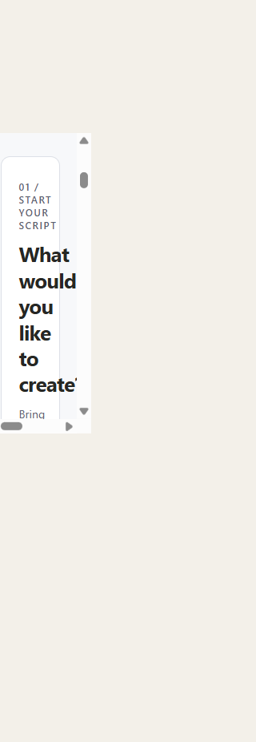
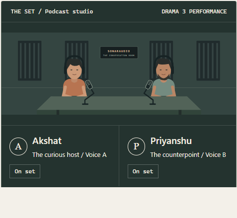
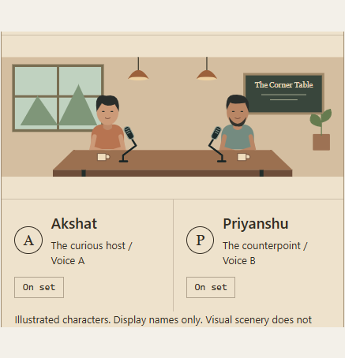
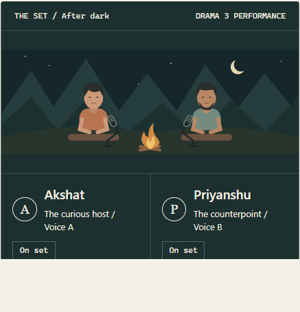

# SonarAudio Scenes

**Same conversation. A different atmosphere.**

A two-character podcast scene studio: edit, import or draft a script with Workers AI, direct each line with Fish Drama 3, and let the audience choose the ending.

**Live demo:** [sonaraudio.vercel.app](https://sonaraudio.vercel.app/)

**Repository:** [mukulpythondev/sonaraudio](https://github.com/mukulpythondev/sonaraudio)

> Hackathon prototype: Workers AI drafting and text import are operational. Audio upload/transcription is disabled. Before public deployment with funded keys, add authentication and server-side usage limits.

## UI screenshots

Actual local UI captures; these images demonstrate the interface, not audio quality.



The illustrated-set captures below predate the latest workspace redesign.



| Corner cafe | After dark |
| --- | --- |
|  |  |

The illustrated cast is **Akshat (Voice A)** and **Priyanshu (Voice B)**. Each setting has its own original vector set: acoustic panels and boom microphones in the studio, a café table/window, or an outdoor campfire with stand microphones. A current-turn marker follows the playback sequence; it is not an audio-level meter. Names are character labels, not verified identities of the configured voices.

Formerly BolBhaav. The folder name is retained to avoid breaking local setup. The earlier `/phrase-studio` URL now redirects to the main studio. Its saved browser favorites are left untouched; the old phrase page is no longer exposed.

## Start

Requires Node.js 22.13+ and npm. From this directory:

```powershell
npm ci
Copy-Item .env.example .env.local
npm run dev
```

Do not overwrite an existing local configuration. Open <http://127.0.0.1:3000>. The existing production preview uses port 3100 when started with `npm start -- --port 3100`.

## Folder structure

```text
sonaraudio/                 # Repository root; local checkout may still be named bolbhaav
  src/
    app/                   # Next.js pages and server-only API routes
      api/                 # Script drafting, Fish speech, disabled transcription route
      phrase-studio/       # Compatibility redirect to the main studio
    components/            # Scene editor, illustrated sets, import interfaces
    lib/                   # Validation, script parsing, provider configuration
  tests/                   # Vitest contracts and mocked provider tests
  docs/                    # Scope, architecture, sprints, demo and verification
    screenshots/           # Actual studio, cafe and campfire UI captures
  .env.example             # Configuration names only; never real credentials
  package.json
  package-lock.json
```

Without credentials, the original editable script works and **browser rehearsal** is clearly labeled. Browser speech does not demonstrate Fish voices, emotions, or environment performance and is not guaranteed offline.

## Server configuration

Edit `.env.local` locally, or use the server environment. Next.js also reads `.env`; `.env.local` takes precedence. Never paste secrets into chat.

```dotenv
FISH_API_KEY=your_private_key
FISH_VOICE_A=first_authorized_voice_id
FISH_VOICE_B=second_authorized_voice_id
GEMINI_API_KEY=your_optional_google_key
GEMINI_MODEL=gemini-2.5-flash-lite
CLOUDFLARE_API_TOKEN=your_private_workers_ai_token
CLOUDFLARE_ACCOUNT_ID=your_cloudflare_account_id
CLOUDFLARE_MODEL=@cf/meta/llama-3.1-8b-instruct
```

Use two distinct voices you have permission to use. `FISH_AUDIO_KEY` is also accepted as an alias for `FISH_API_KEY`; if both are set, `FISH_API_KEY` takes precedence. Scene speech always explicitly requests **`drama-3`**, with no automatic fallback. The legacy phrase studio separately uses `FISH_REFERENCE_ID` and `FISH_MODEL`.

Restart after configuration changes. Readiness labels mean configuration is present, not that keys, credits, voice permissions, or model access have been authenticated.

`gemini-2.5-flash-lite` is the default. Override `GEMINI_MODEL` with a supported model ID; errors remain explicit and there is no automatic model fallback. Model access and request quotas depend on your Google project and tier; the app does not guarantee a 10-request-per-minute allowance. Drafting makes one request per action, with no automatic retries.

When either Cloudflare credential is configured, **Workers AI takes precedence** for drafting; both credentials must be valid. Gemini remains available only when neither Cloudflare credential is configured. There is no error-triggered provider fallback. Create an account-scoped token with Workers AI Read and Edit permissions. No SDK dependency is needed: requests use the documented REST API. Token verification alone is not proof of inference access.

## Import a script

- Open **Import a two-speaker text script** and choose a UTF-8 `.txt` file up to 64 KiB. Parsing stays in the browser and uses no AI credits.
- Label turns `Speaker 1:` / `Speaker 2:` (also `Speak 1/2`, `A/B`, `Akshat/Priyanshu`). Unlabeled continuation lines belong to the previous turn. Unknown speaker labels are rejected rather than guessed.
- Review before replacing the opening. Long turns split at word boundaries into lines of up to 280 characters, with a maximum of 40 opening lines. Imported lines start with warm delivery.
- Both endings remain unchanged and must be reviewed for relevance. Save the imported scene explicitly if you want it to survive refresh.
- **Audio import is unavailable in this build.** Cloudflare documents Nova-3 diarization, but the public REST transport for binary audio plus diarization options could not be verified. The UI explains the limitation and disables upload; no paid transcription requests are guessed. Transcript parsing and speaker-mapping helpers are tested scaffolding, not a working transcription feature.

## Implemented workflow

The creator workspace provides direct Script/Preview navigation, a live opening-line summary, import entry point, and a compact three-step workflow. Provider diagnostics and unavailable audio-import controls remain accessible in expandable details rather than competing with the core editing actions.

Script setup comes before visual settings and has four mutually exclusive starting points: **Write or paste**, **Upload a script**, **Generate with AI**, or **Try an example**. Write/Paste is the default and uses the same local labeled-script parser as text upload. Switching panels never replaces the current script; only an explicit confirmed paste/import, successful generation, or confirmed example load does. Fish Audio is the default when configured; browser rehearsal is an optional fallback under Playback settings, always labeled when active. Entry, panel and hover animations respect reduced-motion preferences.

1. **Write:** use the original "Small Detours" script, import labeled text, or request a topic-based AI draft.
2. **Review:** edit the title, dialogue, speakers, delivery, and audience-choice labels.
3. **Set the scene:** podcast studio, corner café, or after-dark campfire performance.
4. **Listen:** play an individual line or the full opening.
5. **Choose:** select one of two alternative continuations.
6. **Keep:** save/load script text locally and download individual generated MP3s.

### Scope boundaries

- Environment switches change delivery instructions and UI accents. They do **not** add ambience, room simulation, reverb, or background sound.
- Two AI-voiced characters perform a script; this is not two autonomous agents debating in real time.
- Workers AI (or optional Gemini) drafts dialogue; Fish produces voices. Services run only after explicit user actions.
- Changing setting, speaker, tone, or text cancels current playback. Cache identity includes every generation input.
- Up to 24 generated clips are held in session memory. Audio does not survive reload; download takes to retain them.
- Save script stores text only on this browser. Generated drafts do not overwrite edits unless successfully validated.
- Each scene has 2–40 opening lines and exactly two branches of 2–4 lines each, with at most 280 Unicode code points per line. AI drafts still request short four-line openings.
- No voice cloning, background-audio library, arbitrary markup, public accounts, or clinical claims.

## Privacy and cost

Drafting sends the topic to Cloudflare (or Google when Cloudflare is not configured). Audio transcription is disabled and sends no recordings. Local text import sends no file to a provider. Live speech sends each line and performance instruction to Fish. Browser rehearsal may use the browser/OS speech service. Avoid sensitive data.

Each uncached live line costs a Fish request; a four-line opening may make four sequential requests. New settings produce different cache keys and new requests. No automatic retries, no automatic speech on editing, and no provider calls in tests.

Long imported openings require confirmation before full Fish playback. Forty uncached lines can make forty requests; the 24-clip cache cannot retain an entire 40-line opening. Confirmation is not a quota guard or hard spend cap.

Keys and voice IDs remain server-side. No analytics or external fonts are loaded. This laptop prototype binds to loopback. **Do not expose it publicly with funded keys:** it has no authentication, durable rate limiting, or hard spend cap.

## Validation

```powershell
npm run lint
npm run typecheck
npm test
npm run build
npm start
```

See [testing](docs/TESTING.md) for observed results and pending real-provider checks.

## Documentation

- [Current project scope](docs/PROJECT.md)
- [Sprints and event checklist](docs/SPRINTS.md)
- [Architecture and data handling](docs/ARCHITECTURE.md)
- [Demo script and submission](docs/DEMO.md)
- [Testing guide](docs/TESTING.md)
- [Earlier 24-hour speech-board roadmap](docs/ROADMAP_24H.md) — superseded, not the current build

## Troubleshooting

| Symptom | Action |
|---|---|
| Browser rehearsal only | Set key and two distinct voice IDs; restart. |
| Draft button disabled | Configure Cloudflare credentials, or Gemini when Cloudflare is not configured; original script remains usable. |
| Fish rejects generation | Check Drama 3 entitlement, voice permissions, credits, and key. |
| Gemini rejects generation | Check key, quota, billing, and model availability. |
| Invalid Gemini draft | Retry manually; previous script is retained. |
| Playback blocked | Click the line again; a generated take is reused when cached. |
| Slow opening | Each uncached line generates sequentially; rehearse and cache beforehand. |
| Different output after setting change | Intended: a new performance direction requires a new take. |
| Script not restored on reload | Click Load saved; loading is explicit, not automatic. |

## Event use

Disclose the pre-event foundation and distinguish it from on-site scene-studio work. Confirm organizer eligibility. Do not claim all code was built during the event or claim an untested provider integration was listening-verified.

## Provider references

- [Drama 3](https://docs.fish.audio/features/text-to-speech/drama-3)
- [Gemini models](https://ai.google.dev/gemini-api/docs/models)
- [Gemini structured output](https://ai.google.dev/gemini-api/docs/structured-output)
- [GenerateContent API](https://ai.google.dev/api/generate-content)
